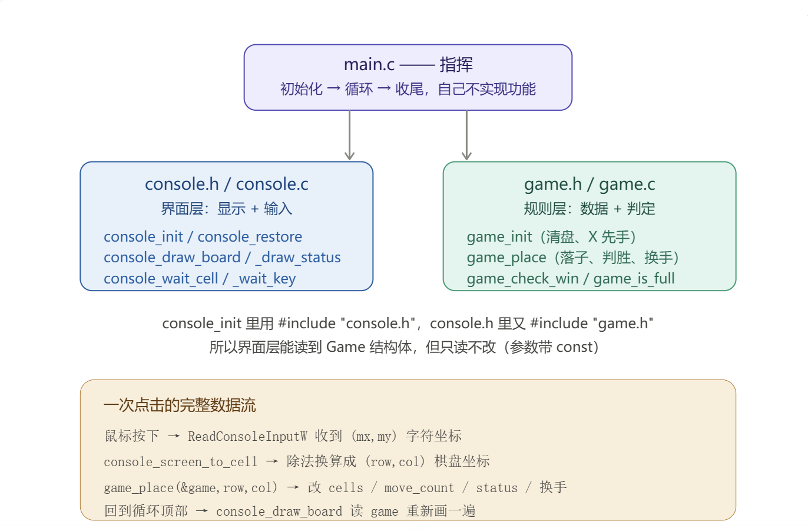

# 扫盲
**#define是什么?**
是预处理阶段编译前的文本替换，常用在定常量，条件编译，头文件保护中。

**什么是宏？**
#define MAX 100         // 定义宏：给 100 起外号叫 MAX
int a[MAX];            // 你写的
int a[100];            // 编译器真正看到的（MAX 被替换掉了）
而宏本身分两种，区别就在于名字后面有没有括号（带不带参数）​：
* 对象式宏：没有参数，用起来像常量
* 函数式宏：带参数，用起来像函数

**enum是什么？**
enum（枚举）=给一串整数起名字。
enum GameStatus {
    GAME_RUNNING,      // 自动 = 0
    GAME_X_WINS,       // 自动 = 1
    GAME_O_WINS,       // 自动 = 2
    GAME_DRAW          // 自动 = 3
};

enum GameStatus status = GAME_RUNNING;    
if (status == GAME_X_WINS) { ... }        // 比 status == 1 清楚
核心：让代码自己说明自己

规则：
* 默认从0开始
* 可以手动指定

**宏和define 的关系：**
一句话概括：#define 是"动作"，宏是"结果"​。#define 是 C 预处理指令之一，用来定义宏；宏则是被这条指令造出来的那个东西。

**什么是.c和.h文件？**
| | `.h` 头文件 | `.c` 源文件 |
|---|---|---|
| 装什么 | **声明**：宏、枚举、结构体、函数原型 | **定义**：函数的实际代码（函数体） |
| 作用 | 告诉别人"有哪些东西可以用" | 真正实现"这些东西怎么做" |
| 编译产物 | 自己不产生任何机器码 | 编译成一个 `.o` 目标文件 |
| 能否重复 | 可以被好几个 `.c` 包含（有防重保护） | 一个函数只能定义一次，否则链接报错 |

* |（按位或）：两个数某一位只要有一个是 1，结果那一位就是 1。​ → 用途：打开某个开关。
* ~（按位取反）：把每一位 0 变 1、1 变 0。​ & 呢？两个数某一位必须都是 1，结果那一位才是 1。​ 所以 ~ 造出一张“只有目标位是 0、其他位全是 1”的网，再用 & 盖上去，效果就是只把目标位清 0，其他位一根头发都不动 → 用途：关闭某个开关。

for “( ; ; )” 是“死循环”的写法（三个部分全空）。它退出的唯一方式是从里面 return 出去。
# 思考过程

### main.c主函数负责协调
首先要定义游戏数据，终端状态和鼠标点中的棋盘坐标，接着初始化game和gameconsole（要看它是不是在真实的终端里）
接着进行主循环：
先绘制棋盘和底部的状态，然后等待一次有效的鼠标格子点击，并且把字符坐标换算成棋盘坐标。最后game_place进行落子，而且要考虑如果格子里已经有子时什么都不要做。这就是一个完整流程，然后开始循环
最后进行收尾，再把最终盘面和结果都留在屏幕上，最后**恢复控制台状态**，return 0.

### console.h
棋盘在终端里的摆放位置：
console.h引用坐标，绘制棋盘时，要考虑棋盘在终端占多大地方。所以看一行是1+9*4=37个字符，换成公式就是1+BOARD_SIZE*BOARD_PITcH_X;一列就是1+9*2=19，换成公式就是1+BOARD_SIZE*BOARD_PITCH_Y
STATUS_Y=20,棋盘占了y=0到y=18这19行，空一行之后从y=20这一行开始显示当前玩家，游戏状态，有效步数等
规定完棋盘多高多宽，就可以判断哪些点在右竖线外和棋盘下方，需要忽略

控制台状态：
原来的输入模式必须要存下来，退出时还原回去
用结构体能方便一点

函数声明：
要考虑初始化控制台，全都弄完后恢复控制台状态。
然后要画出整个棋盘和它下面的信息状态：当前玩家，游戏状态，有效步骤
鼠标点在终端的字符坐标要转换为棋盘里的坐标
*还要考虑在等待鼠标移动和按键，点在棋盘外和键盘按键要忽略

### console.c
(是终端界面的实现，需要用到Windows Console API)
有的老开发环境里没有ENABLE_QUICK_EDIT_MODE 和 ENABLE_EXTENDED_FLAGS这两个宏，所以要补上避免缺失定义
printf是 从光标当前位置往后写，此处写下棋子的位置做不到，所以要用put
然后再写边框
console_init 把终端“改装”成能收鼠标的样子
console_restore 在退出时把改装拆掉、恢复原厂设置
QUICK_EDIT 必须关：终端默认开着“快速编辑模式”，鼠标一点就被终端拿去选中文字
C 的字符串结尾藏着一个看不见的结束符 '\0'，37 个可见字符需要 38 个格子装。
 draw_board = 双层循环拼字符串 + 按公式 y=1+2r 逐行贴上屏幕；draw_status = 挪光标 + printf（行尾补空格擦旧字）。棋盘上画什么完全由 cells[r][c] 决定，显示不参与游戏逻辑。
 先判范围。BOARD_SIZE * BOARD_PITCH_X = 9 × 4 = 36，也就是合法的 x 是 0~35；纵向是 9 × 2 = 18，合法 y 是 0~17。超出这个范围（点在最右竖线右边、或状态行上）直接 return 0 “这次点击无效”。

 ### game.h
 首先define四个基础常量
 然后定义两个枚举，分别显示游戏状态和下棋结果

 ### game.c
 要先清棋盘重置一局，把内存的垃圾值清掉。
 然后判断胜负，检查刚落下的这一子以它为中心向前后左右四个方向和两个斜对角数是否满五个棋子；如果没分出胜负，再看是否平局，如果未平局，最后再换手下一轮
 **game.h 是规则层的目录页（常量、枚举、数据、接口），game.c 是它的实现；判胜用的是“只查刚落这颗子 + 四线各数两边”的取巧算法；落子函数里“先判越界 → 再判占用 → 才写入 → 赢/平局/换手”。**

流程图：